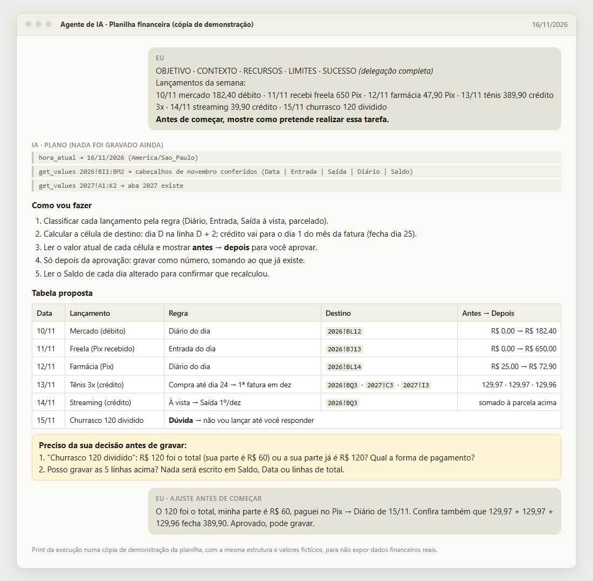
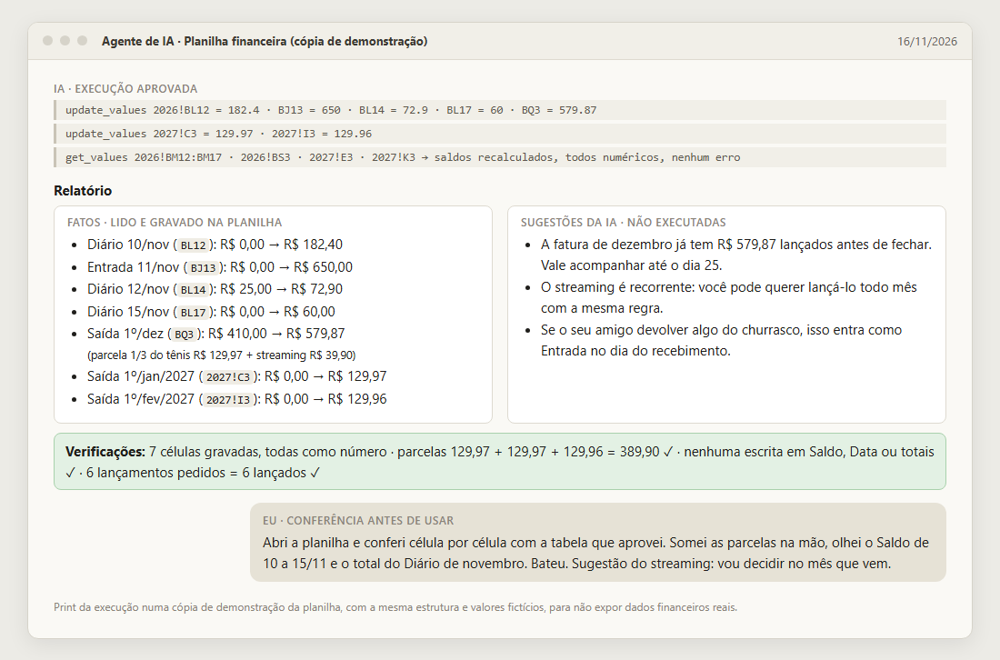

# Meu Kit de IA

Desafio de Projeto da [DIO](https://dio.me): monte o seu kit de IA para o dia a dia e delegue uma tarefa real, com você no comando.

O kit foi criado pelo Expert Bruno Lima com os prompts, templates, checklists e skills usados nas Aulas. Ele não é uma apostila: abra a pasta que resolve o seu problema, copie o modelo, adapte e use.

**Copie → adapte → teste → confira → melhore**

## Como Fazer o Desafio

Você não precisa instalar nada nem saber programar. Tudo acontece no navegador.

1. Clique em **Use this template**, depois em **Create a new repository**. Dê um nome simples, como `meu-kit-de-ia`, deixe **Public** e confirme.
2. Siga os passos abaixo com uma tarefa real da sua semana.
3. Preencha a seção [Minha Entrega](#minha-entrega) da sua cópia e entregue o link dela na DIO.

## Os Passos

1. **Escolha uma tarefa real.** Comece pelo trabalho que se repete na sua semana, como preparar uma reunião ou montar um relatório, e não pela ferramenta.
2. **Pegue um modelo.** Abra a pasta do kit que combina com a sua tarefa. Cada modelo tem um botão de copiar no canto.
3. **Adapte.** Troque o que está entre colchetes pelo seu contexto, objetivo, dados, limites e formato.
4. **Teste.** A primeira resposta é um ponto de partida. Ajuste até funcionar para a sua realidade.
5. **Delegue.** Com o [template de delegação](02-templates/03-delegacao.md), entregue a tarefa à IA. Peça o plano antes de ela começar, acompanhe e valide o resultado.
6. **Confira.** Provável não é o mesmo que verdadeiro. Revise com o [Pare, Confira, Use](03-checklists/01-pare-confira-use.md) antes de usar.

## O Que Tem no Kit

| Pasta | Para que serve |
|---|---|
| [01-prompts](01-prompts) | Pedidos prontos para adaptar: escrita, comunicação, pesquisa, comparação e preparação de reuniões |
| [02-templates](02-templates) | Estruturas para preencher: bom pedido, pesquisa e decisão, e delegação |
| [03-checklists](03-checklists) | Revisão de respostas, de textos e de tarefas delegadas |
| [04-skills](04-skills) | Como criar uma skill, e a Skill Preparador de Reuniões usada nas Aulas |
| [05-delegacao-e-automacao](05-delegacao-e-automacao) | Gatilhos de automação, supervisão e checkpoints |

## Os Frameworks das Aulas

- **Bom pedido:** contexto + instrução + objetivo + formato. Quanto menos a IA precisa adivinhar, melhor você consegue avaliar a resposta.
- **Pesquisa e decisão:** pergunta → pesquisa → critérios → comparação → você. Peça fontes quando precisar de informação externa. A decisão final é sua.
- **Segurança:** pare → confira → use. Valide fatos, números, datas, fontes e contexto.
- **Atalhos reutilizáveis:** criar → testar → ajustar → salvar. Separe as instruções fixas das informações que mudam a cada uso.
- **Delegação:** objetivo + contexto + recursos + limites + sucesso. Autonomia funciona melhor quando o resultado esperado está claro.
- **Supervisão:** definir → delegar → acompanhar → validar. Em tarefas maiores, confira o plano, acompanhe os checkpoints e valide o resultado.

> A IA pode ajudar você a escrever, pesquisar, organizar e executar. A responsabilidade pelo resultado continua sendo sua.

---

## Minha Entrega

Kit adaptado para uma tarefa que eu já faço toda semana: **lançar gastos e entradas na minha planilha de controle financeiro no Google Sheets**, com um agente de IA conectado à planilha.

| Arquivo novo | O que é |
|---|---|
| [01-prompts/06-lancar-na-planilha.md](01-prompts/06-lancar-na-planilha.md) | Atalho 1: lançar gastos e entradas |
| [01-prompts/07-fechamento-do-mes.md](01-prompts/07-fechamento-do-mes.md) | Atalho 2: fechamento do mês (só leitura) |
| [02-templates/04-minha-delegacao-planilha.md](02-templates/04-minha-delegacao-planilha.md) | A delegação completa e as ações que esperam a minha aprovação |
| [04-skills/03-skill-lancador-de-planilha.md](04-skills/03-skill-lancador-de-planilha.md) | O atalho que mais uso transformado em skill |

### Minha Tarefa Real

Todo dia eu gasto alguma coisa e toda semana preciso passar isso para a minha planilha de controle financeiro no Google Sheets. A planilha tem um bloco de colunas por mês (Data, Entrada, Saída, Diário e Saldo), e cada tipo de gasto vai para um lugar diferente: Pix e débito vão no Diário do dia, compra no crédito vai para o dia 1 do mês da fatura (que fecha no dia 25), e compra parcelada precisa ser dividida em vários meses, às vezes passando para a aba do ano seguinte.

Fazer isso na mão tomava tempo e gerava erro: parcela no mês errado, valor digitado como texto que quebrava a fórmula do Saldo, lançamento esquecido. Vale a pena porque é repetitivo, tem regras claras e o erro custa caro (o saldo do mês fica errado sem eu perceber).

### Meus Atalhos

Adaptei dois modelos do kit:

- **[Template do Bom Pedido](02-templates/01-bom-prompt.md) → Lançar na Planilha.** O **fixo** é o contexto (estrutura da planilha e regras de cada forma de pagamento), o objetivo e o formato da resposta. O que **muda a cada uso** é só o bloco `LANÇAMENTOS`. Nos testes, ajustei o atalho em dois pontos: gravar sempre número (valor como texto, tipo "R$ 46,99", quebra a fórmula do Saldo) e mostrar uma tabela antes → depois para eu aprovar antes de gravar.
- **[Template de Pesquisa e Decisão](02-templates/02-pesquisa-e-decisao.md) → Fechamento do Mês.** O **fixo** é onde ficam os totais, os critérios de análise e a separação entre fatos e sugestões. O que **muda** é o mês analisado e o de comparação. É só leitura: a IA não altera nenhuma célula.

```text
CONTEXTO
Tenho uma planilha de controle financeiro no Google Sheets.
- Uma aba por ano. Cada mês é um bloco de colunas: Data | Entrada | Saída | Diário | Saldo.
- Linha 1 = mês, linha 2 = cabeçalhos, o dia D fica na linha D + 2.
- Saldo é fórmula. Data e as linhas de total (34 para baixo) não podem ser editadas.
- Pix, débito, dinheiro ou sem forma de pagamento → coluna Diário do dia da compra.
- Crédito à vista → Saída do dia 1 do mês da fatura (fecha dia 25: compra até dia 24 vai
  para o mês seguinte; do dia 25 em diante, para daqui a 2 meses).
- Crédito parcelado em N vezes → uma parcela na Saída do dia 1 de N meses seguidos,
  arredondando centavos e deixando a diferença na última parcela.
- Dinheiro recebido → coluna Entrada do dia.

INSTRUÇÃO
Para cada lançamento abaixo, diga a aba, a célula de destino, o valor atual e o novo valor
(somando ao que já existe). Se algum lançamento estiver ambíguo, pergunte antes.

LANÇAMENTOS
[cole aqui, um por linha: data, descrição, valor, forma de pagamento]

OBJETIVO
Manter o saldo do mês correto sem quebrar as fórmulas da planilha.

FORMATO
Uma tabela: Data | Descrição | Regra aplicada | Aba!Célula | Antes → Depois.
Valores no formato brasileiro (R$ 1.234,56). Não grave nada antes de eu aprovar a tabela.
```

```text
PERGUNTA
Como foi o meu mês de [mês/ano] em comparação com [mês anterior]?

PESQUISA
Leia na minha planilha financeira do Google Sheets os totais de [mês] e [mês anterior]
(Entradas, Saídas, Diário, Saída Total e Performance ficam logo abaixo do dia 31)
e os valores diários da coluna Diário.

FONTES E EVIDÊNCIAS
Cite a aba e as células de cada número que usar. Se uma célula estiver vazia ou com erro,
diga isso em vez de estimar.

CRITÉRIOS
- variação do Diário (gasto do dia a dia) entre os dois meses;
- peso da fatura do cartão (Saída do dia 1) no mês;
- dias com gasto fora do padrão (mais que o dobro da média diária).

COMPARAÇÃO
Uma tabela com os dois meses lado a lado e a variação em R$ e em %.

DECISÃO
Separe em duas listas: "Fatos lidos na planilha" e "Sugestões da IA".
A decisão do que mudar é minha. Não altere nenhuma célula.
```

### Minha Delegação

Montei a partir do [Template de Delegação](02-templates/03-delegacao.md) e conferi com o [Checklist Antes de Delegar](03-checklists/03-antes-de-delegar.md). A IA pode ler a planilha e montar a tabela sozinha; **gravar qualquer célula só depois da minha aprovação**, e se algo estiver ambíguo ela para e pergunta.

```text
OBJETIVO
Lançar na minha planilha de controle financeiro todos os gastos e entradas da semana,
cada um na célula certa, sem quebrar as fórmulas de saldo.

CONTEXTO
- Planilha no Google Sheets, uma aba por ano. Cada mês é um bloco de colunas
  Data | Entrada | Saída | Diário | Saldo, e o dia D fica na linha D + 2.
- Pix, débito, dinheiro ou sem forma informada → Diário do dia da compra.
- Crédito à vista → Saída do dia 1 do mês da fatura. A fatura fecha no dia 25.
- Crédito parcelado → uma parcela na Saída do dia 1 de cada mês, a diferença de
  centavos fica na última parcela.
- Dinheiro recebido → Entrada do dia.
- Lançamentos da semana:
  10/11 mercado 182,40 débito · 11/11 recebi freela 650 Pix · 12/11 farmácia 47,90 Pix
  13/11 tênis 389,90 crédito 3x · 14/11 streaming 39,90 crédito · 15/11 churrasco 120 dividido

RECURSOS
- Conector do Google Sheets: ler valores e gravar valores.
- A data de hoje, consultada na ferramenta de hora (não chutar).
- Só esta planilha. Nenhum outro arquivo, e-mail ou banco.

LIMITES
- Não grave nada antes de eu aprovar a tabela de lançamentos.
- Nunca escreva nas colunas Saldo e Data nem nas linhas de total.
- Nunca apague um valor existente: some ao que já está na célula.
- Grave sempre número, nunca texto ("R$ 46,99" como texto quebra o Saldo).
- Se a aba do ano não existir ou um lançamento estiver ambíguo, pare e pergunte.

SUCESSO
- Cada lançamento está na célula prevista na tabela aprovada.
- Depois de gravar, o Saldo de cada dia alterado recalculou sem erro.
- Recebo um relatório com uma linha por célula: Aba!Célula, antes → depois,
  separando o que é fato (lido/gravado) do que é sugestão da IA.

Antes de começar, mostre como pretende realizar essa tarefa.
```

### O Plano da IA



A IA leu os cabeçalhos da planilha, confirmou que a aba do ano seguinte existia e mostrou a tabela com cada célula de destino **antes de gravar qualquer coisa**. Ela travou em um lançamento ambíguo ("churrasco 120 dividido") em vez de chutar. Antes de liberar a execução, eu ajustei: o R$ 120 era o total e a minha parte foi R$ 60 no Pix (vai para o Diário de 15/11), e pedi para conferir se as 3 parcelas do tênis fechavam o valor da compra. Só então aprovei.

### O Resultado



A IA gravou 7 células, todas como número, e leu o Saldo de cada dia alterado para confirmar o recálculo. O relatório separa **fatos** (o que foi lido e gravado, com antes → depois de cada célula) de **sugestões da IA** (que ela não executou). Antes de usar, abri a planilha e conferi célula por célula com a tabela aprovada, somei as parcelas (129,97 + 129,97 + 129,96 = 389,90) e olhei o Saldo de 10 a 15/11. A sugestão sobre o streaming recorrente ficou para eu decidir depois.

> Para não expor os meus dados financeiros, os prints foram feitos numa cópia de demonstração da planilha, com a mesma estrutura e valores fictícios.

### Como Foi para Você

Antes eu lançava tudo na mão e só descobria o erro quando o saldo do mês não batia. Agora eu só escrevo o que gastei em linguagem normal ("13/11 tênis 389,90 crédito 3x") e a IA calcula a célula, a fatura e as parcelas. O que mais mudou foi o meu papel: em vez de digitar, eu confiro uma tabela e aprovo. A regra de "nada é gravado sem a minha aprovação" e a separação entre fato e sugestão me deram confiança para deixar a IA mexer numa planilha que é importante para mim.
